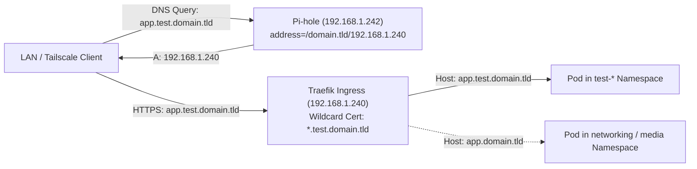

# ADR 001: Test Subdomain Environment & Namespace Isolation Architecture

- **Status:** Accepted
- **Date:** 2026-11-11
- **Issue:** [#35](https://github.com/ManuelSaleta/homelab/issues/35)
- **Deciders:** Manuel Saleta

---

## 1. Context & Problem Statement

Currently, all Kubernetes Ingress routes, TLS certificates, Pi-hole DNS overrides, and application configurations in the `Mothership` homelab operate directly against the production root domain (`${DOMAIN_NAME}`).

Testing new application manifests, container image upgrades (such as `vpn-media-sync` / `Sync.Sharp`), Traefik middleware rules, or SSO/authentication flows directly on `${DOMAIN_NAME}` introduces several operational risks:

1. **Ingress & Host Collisions:** Deploying an experimental version of a service cannot share the same `Host` header (e.g., `plex.${DOMAIN_NAME}`) without hijacking live traffic.
2. **State & Session Contamination:** Browser cookies, HSTS policies, and authentication tokens scoped to `${DOMAIN_NAME}` or production subdomains can conflict between test and production instances.
3. **Let's Encrypt Rate Limiting:** Repeatedly creating and destroying individual per-pod TLS certificates during iterative testing risks exhausting Let's Encrypt's 50-certificates-per-registered-domain-per-week limit.
4. **Storage Corruption:** Accidentally binding a test workload to a production `ReadWriteOnce` NFS volume (especially SQLite-backed workloads like Vaultwarden, Prowlarr, Karakeep, or Navidrome) can corrupt live databases.

We need a standardized, low-overhead architecture for hosting isolated test workloads under a dedicated subdomain within the constraints of our single-host Proxmox VE environment (`16 GB` physical RAM).

---

## 2. Architecture Evaluation & Decisions

### 2.1 DNS & Routing Structure: `<app>.test.${DOMAIN_NAME}` vs `test-<app>.${DOMAIN_NAME}`

| Criterion | Option A: Sub-Zone `<app>.test.${DOMAIN_NAME}` (Selected) | Option B: Prefix `test-<app>.${DOMAIN_NAME}` |
| :--- | :--- | :--- |
| **Manifest Reusability** | **High** — Existing `<app>.${DOMAIN_NAME}` manifests work unchanged by passing `DOMAIN_NAME=${TEST_DOMAIN_NAME}` (`test.${DOMAIN_NAME}`) to `envsubst`. | **Low** — Requires modifying every `host:` and `href:` string from `<app>.${DOMAIN_NAME}` to `${ENV_PREFIX}<app>.${DOMAIN_NAME}`. |
| **Pi-hole LAN DNS (`dnsmasq`)** | **Zero Config** — `address=/${DOMAIN_NAME}/192.168.1.240` in `dnsmasq` automatically resolves all nested depths (`*.test.${DOMAIN_NAME}`) to the Traefik MetalLB VIP (`192.168.1.240`). | **Zero Config** — Also matched by `address=/${DOMAIN_NAME}/192.168.1.240`. |
| **Cookie & Origin Isolation** | **Strict** — Cookies scoped to `.test.${DOMAIN_NAME}` cannot leak to other production subdomains. | **Shared Parent** — Broad cookies on `.${DOMAIN_NAME}` apply to `test-<app>.${DOMAIN_NAME}`. |
| **Traefik ACME DNS-01 TLS** | **Supported** — Let's Encrypt issues `*.test.${DOMAIN_NAME}` via `_acme-challenge.test.${DOMAIN_NAME}` TXT record in the parent Cloudflare zone. | **Supported** — Covered by a single `*.${DOMAIN_NAME}` wildcard certificate. |
| **Cloudflare Public Tunnel** | **Blocked by Default (Security Benefit)** — Cloudflare Free Universal SSL only covers first-level `*.${DOMAIN_NAME}`, preventing accidental public exposure of `*.test.${DOMAIN_NAME}` without paid Advanced Certificate Manager. | **Exposed Eligible** — Covered by Cloudflare Free Universal SSL if wildcard tunnel routes are added. |

**Decision:** Adopt **Option A (`<app>.test.${DOMAIN_NAME}`)** parameterized via `TEST_DOMAIN_NAME=test.${DOMAIN_NAME}`. Test services are strictly **LAN-only** (and accessible remotely over Tailscale split-DNS) and are **never** routed through the public `cloudflared` Zero Trust tunnel.



---

### 2.2 TLS / Certificate Automation (Traefik ACME DNS-01)

1. **No Sub-Zone NS Delegation Needed:** Because Cloudflare hosts the authoritative DNS zone for `${DOMAIN_NAME}`, Traefik's `cloudflare` DNS-01 provider (`CLOUDFLARE_DNS_API_TOKEN`) can create `_acme-challenge.test.${DOMAIN_NAME}` TXT records directly inside the root zone.
2. **Wildcard Certificate Consolidation (`*.test.${DOMAIN_NAME}`):**
   - Instead of requesting a separate Let's Encrypt certificate for every test Ingress (`plex.test.${DOMAIN_NAME}`, `sync.test.${DOMAIN_NAME}`, etc.), Traefik should configure default SAN wildcard domains on the `websecure` entrypoint:
     - Main: `${DOMAIN_NAME}`, SANs: `*.${DOMAIN_NAME}`
     - Main: `test.${DOMAIN_NAME}`, SANs: `*.test.${DOMAIN_NAME}`
   - This guarantees that spinning up or tearing down test Ingresses reuses the cached wildcard certificate in `/data/acme.json` with zero ACME rate-limit consumption and instant HTTPS readiness.

---

### 2.3 Namespace Isolation vs. Dedicated Staging Cluster

| Dimension | Isolated Test Namespaces (`test-networking`, `test-media`) (Selected) | Dedicated K3s Staging Cluster |
| :--- | :--- | :--- |
| **RAM Footprint on `mothership` (16 GB limit)** | **0 MB idle overhead** — Shares existing `k3s-control-01` (2 GB) and `k3s-worker-01` (10 GB). | **+3–4 GB minimum** — Requires at least one extra K3s VM, exceeding the 13.5 GB guest budget. |
| **Ingress & MetalLB IP Consumption** | **0 extra IPs** — Reuses Traefik (`192.168.1.240`) via HTTP `Host` header multiplexing. | **+1–2 LoadBalancer IPs** — Requires separate MetalLB pool and Traefik instance. |
| **Blast Radius Protection** | Enforced via Kubernetes `ResourceQuota`, `LimitRange`, and distinct PVCs/`emptyDir`. | Full VM/API server isolation, but unaffordable within 16 GB host memory. |

**Decision:** Use dedicated **Test Namespaces** (`test-networking` and `test-media`) inside the existing K3s cluster, governed by three safety guardrails:

1. **Resource Quotas (`ResourceQuota` & `LimitRange`):** Cap total aggregate test namespace memory (e.g., `requests.memory: 1Gi`, `limits.memory: 2Gi`) so a runaway test container can never OOM-kill production workloads on `k3s-worker-01`.
2. **Strict Storage Decoupling:**
   - Ephemeral smoke tests must use `emptyDir: { sizeLimit: 2Gi }` instead of NFS PVCs.
   - Persistent integration tests must mount isolated NFS directories under `/mnt/export/storage/test/<app>` on `micro-nas` (`192.168.1.250`) and **never** reference production PVs/PVCs.
3. **Homepage Dashboard Segregation:**
   - Test Ingress resources must set either `gethomepage.dev/enabled: "false"` or `gethomepage.dev/group: "Test"` with `gethomepage.dev/name: "<App> (Test)"` so auto-discovery does not overwrite production dashboard widgets.

---

### 2.4 Configuration Parameterization

To support `<app>.test.${DOMAIN_NAME}` without duplicating YAML manifests:

1. **Terraform (`variables.tf` & `terraform.tfvars.example`):**
   - Add optional variable `test_domain_name` (defaults to `""`, which the `Makefile` resolves to `test.${DOMAIN_NAME}`).
2. **Makefile (`TEST_DOMAIN_NAME`):**
   - Define `TEST_DOMAIN_NAME ?= test.$(DOMAIN_NAME)`.
   - Provide `APPLY_TEST_YAML` and `DELETE_TEST_YAML` macros that override `DOMAIN_NAME=$(TEST_DOMAIN_NAME)` and `HOMELAB_DOMAIN=$(TEST_DOMAIN_NAME)` during `envsubst`, allowing any existing manifest (or test overlay) to render against `*.test.${DOMAIN_NAME}`.

---

## 3. Concrete Implementation Plan

### Step 1: Update Traefik `HelmChartConfig` for Wildcard SANs

Update [`kubernetes/infrastructure/traefik-dns-config.yaml`](../../kubernetes/infrastructure/traefik-dns-config.yaml) to request wildcard certificates for both `*.${DOMAIN_NAME}` and `*.test.${DOMAIN_NAME}` on the `websecure` entrypoint:

```yaml
apiVersion: helm.cattle.io/v1
kind: HelmChartConfig
metadata:
  name: traefik
  namespace: kube-system
spec:
  valuesContent: |-
    # 1. Environment variables (API Token)
    env:
      - name: CLOUDFLARE_DNS_API_TOKEN
        valueFrom:
          secretKeyRef:
            name: cloudflare-dns-api-token
            key: CF_API_TOKEN

    # 2. Structured Let's Encrypt Setup
    certificatesResolvers:
      le-resolver:
        acme:
          email: admin@${DOMAIN_NAME}
          storage: /data/acme.json
          dnsChallenge:
            provider: cloudflare
            resolvers:
              - "1.1.1.1:53"
              - "8.8.8.8:53"

    # 3. Enable TLS and request wildcard SANs for root and test sub-zone
    additionalArguments:
      - "--entryPoints.websecure.http.tls=true"
      - "--entryPoints.websecure.http.tls.certResolver=le-resolver"
      - "--entryPoints.websecure.http.tls.domains[0].main=${DOMAIN_NAME}"
      - "--entryPoints.websecure.http.tls.domains[0].sans=*.${DOMAIN_NAME}"
      - "--entryPoints.websecure.http.tls.domains[1].main=${TEST_DOMAIN_NAME}"
      - "--entryPoints.websecure.http.tls.domains[1].sans=*.${TEST_DOMAIN_NAME}"

    # 4. Storage configuration
    persistence:
      enabled: true
      path: /data
      mountPath: /data
      size: 128Mi
```

### Step 2: Parameterize `Makefile` and `terraform.tfvars.example`

In [`Makefile`](../../Makefile):

```makefile
# Test sub-zone domain (defaults to test.<DOMAIN_NAME>)
TEST_DOMAIN_NAME ?= $(shell grep -E '^\s*test_domain_name\s*=' $(TERRAFORM_DIR)/terraform.tfvars 2>/dev/null | head -n 1 | cut -d'=' -f2 | tr -d ' "' || echo "")
ifeq ($(strip $(TEST_DOMAIN_NAME)),)
TEST_DOMAIN_NAME := test.$(DOMAIN_NAME)
endif

# Standard & Test manifest substitution macros
APPLY_YAML       = DOMAIN_NAME=$(DOMAIN_NAME) HOMELAB_DOMAIN=$(DOMAIN_NAME) TEST_DOMAIN_NAME=$(TEST_DOMAIN_NAME) envsubst '$${DOMAIN_NAME} $${HOMELAB_DOMAIN} $${TEST_DOMAIN_NAME}' < $(1) | kubectl apply -f -
DELETE_YAML      = DOMAIN_NAME=$(DOMAIN_NAME) HOMELAB_DOMAIN=$(DOMAIN_NAME) TEST_DOMAIN_NAME=$(TEST_DOMAIN_NAME) envsubst '$${DOMAIN_NAME} $${HOMELAB_DOMAIN} $${TEST_DOMAIN_NAME}' < $(1) | kubectl delete --ignore-not-found -f -
APPLY_TEST_YAML  = DOMAIN_NAME=$(TEST_DOMAIN_NAME) HOMELAB_DOMAIN=$(TEST_DOMAIN_NAME) TEST_DOMAIN_NAME=$(TEST_DOMAIN_NAME) envsubst '$${DOMAIN_NAME} $${HOMELAB_DOMAIN} $${TEST_DOMAIN_NAME}' < $(1) | kubectl apply -f -
DELETE_TEST_YAML = DOMAIN_NAME=$(TEST_DOMAIN_NAME) HOMELAB_DOMAIN=$(TEST_DOMAIN_NAME) TEST_DOMAIN_NAME=$(TEST_DOMAIN_NAME) envsubst '$${DOMAIN_NAME} $${HOMELAB_DOMAIN} $${TEST_DOMAIN_NAME}' < $(1) | kubectl delete --ignore-not-found -f -
```

In [`terraform/vm_provisioning/variables.tf`](../../terraform/vm_provisioning/variables.tf) and [`terraform/vm_provisioning/terraform.tfvars.example`](../../terraform/vm_provisioning/terraform.tfvars.example):

```hcl
variable "test_domain_name" {
  type        = string
  description = "Optional override for the test subdomain environment (defaults to test.<homelab_domain>)."
  default     = ""
}
```

### Step 3: Create Isolated Test Namespaces & ResourceQuotas

Create `kubernetes/infrastructure/test-namespaces.yaml` to enforce CPU and memory ceilings on test workloads:

```yaml
apiVersion: v1
kind: Namespace
metadata:
  name: test-networking
  labels:
    environment: test
---
apiVersion: v1
kind: ResourceQuota
metadata:
  name: test-networking-quota
  namespace: test-networking
spec:
  hard:
    requests.cpu: "500m"
    requests.memory: 512Mi
    limits.cpu: "1000m"
    limits.memory: 1Gi
---
apiVersion: v1
kind: Namespace
metadata:
  name: test-media
  labels:
    environment: test
---
apiVersion: v1
kind: ResourceQuota
metadata:
  name: test-media-quota
  namespace: test-media
spec:
  hard:
    requests.cpu: "500m"
    requests.memory: 512Mi
    limits.cpu: "1000m"
    limits.memory: 1Gi
```

### Step 4: Verification Checklist

1. **DNS Resolution:** Run `dig @192.168.1.242 whoami.test.${DOMAIN_NAME} +short` and confirm it returns `192.168.1.240`.
2. **TLS Wildcard Issuance:** Check Traefik logs (`kubectl logs -n kube-system -l app.kubernetes.io/name=traefik`) to confirm Let's Encrypt DNS-01 issues the certificate for `*.test.${DOMAIN_NAME}` without errors.
3. **HTTPS Routing:** Deploy a test Ingress in `test-networking` for `whoami.test.${DOMAIN_NAME}` and verify `curl -I https://whoami.test.${DOMAIN_NAME}` returns `HTTP/2 200` with a valid Let's Encrypt certificate.
