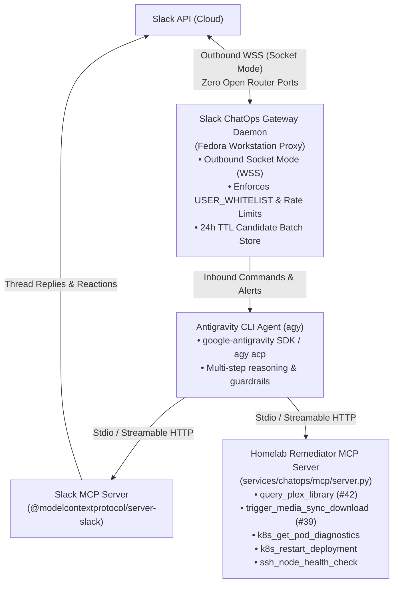

# ADR 002: Zero-Trust Slack ChatOps Gateway & Antigravity MCP Server Integration

- **Status:** Accepted
- **Date:** 2026-11-11
- **Related Issues:** [#39](https://github.com/ManuelSaleta/homelab/issues/39), [#42](https://github.com/ManuelSaleta/homelab/issues/42)

---

## 1. Context & Problem Statement

Homelab services such as `vpn-media-sync` (`Sync.Sharp`) and `promstack-grafana` require a secure mechanism to push interactive notifications (e.g., top-10 trending media candidate batches or cluster alert notifications) to the operator and receive inbound commands or approvals (e.g., `/download 1 3 6 10` or `[🔄 Restart Deployment]`) **without** exposing internal homelab endpoints or opening inbound router ports to the public internet.

Additionally, rather than building a single-purpose webhook relay, the homelab benefits from an intelligent, autonomous ChatOps co-pilot powered by the **Antigravity CLI (`agy`)** and the **Model Context Protocol (MCP)**, while respecting the severe memory constraints of the 16 GB Proxmox host (`mothership`).

---

## 2. Architecture Overview: Decoupled Ingress & Egress

In the MCP architecture, the AI agent acts as the **MCP Client** while homelab subsystems act as **MCP Servers**. Full two-way communication separates **Zero-Trust Inbound Ingress** from **Outbound Tool Execution**:

---

## 3. Key Architecture Decisions

### 3.1 Zero-Trust Inbound Communication: Slack Socket Mode

| Option | Inbound Ports Required | Public DNS / Tunnel Required | Assessment |
| :--- | :--- | :--- | :--- |
| **Slack Socket Mode (Selected)** | **0** (Outbound `wss://wss-primary.slack.com`) | None | Rich Block Kit interactivity, native thread model for alert triage, and official `@modelcontextprotocol/server-slack` ecosystem support. |
| **Discord Gateway (WebSocket)** | **0** (Outbound WSS) | None | Viable zero-port alternative, but lacks native MCP server parity with the existing Slack setup. |
| **Cloudflare Tunnel + Webhook** | 0 router ports, but exposes public HTTPS ingress route | Yes (`cloudflared` + public hostname + HMAC verification) | Rejected to eliminate public ingress surface area altogether. |

### 3.2 Authorization, Rate Limiting & Inter-Service Authentication

1. **Fail-Closed User Whitelist (`USER_WHITELIST`)**:
   - Every inbound Slack slash command (`/download`, `/agy`), `@Antigravity` mention, and interactive Block Kit button action checks the caller's Slack `user_id` against `USER_WHITELIST`.
   - If `USER_WHITELIST` is unset or the `user_id` is not explicitly listed, the gateway rejects the request immediately and logs an audit warning.
2. **Sliding-Window Rate Limiting & Input Sanitization**:
   - Per-user sliding window limiter prevents accidental command floods.
   - All Kubernetes namespace/resource identifiers and node IP addresses passed to MCP tools are validated against strict regex patterns (`^[a-z0-9]([-a-z0-9]*[a-z0-9])?$`) and an explicit node IP allowlist (`192.168.1.180`, `192.168.1.210`, `192.168.1.211`, `192.168.1.50`).
3. **Mutual Secret Webhook Dispatch (`WEBHOOK_SECRET_TOKEN`)**:
   - When the gateway or MCP server dispatches approved media selections to `media-sync`, it includes both `X-Webhook-Secret: <WEBHOOK_SECRET_TOKEN>` and an HMAC-SHA256 payload signature (`X-Signature-SHA256: sha256=<digest>`).

### 3.3 State Management & Interactive UX (`media-sync` Candidate Approval)

- **24-Hour TTL Candidate Batch Store**:
  - `CandidateStateStore` maps 1-based display indices (`[1]..[10]`) to candidate metadata (`imdb_id`, `title`, `year`, `media_type`, `magnet_or_info_hash`).
  - Batches automatically expire after `CANDIDATE_BATCH_TTL_SECONDS` (default `86400` seconds / 24 hours) and are persisted to disk (`~/.local/share/homelab-chatops/candidate_state.json`) so daemon restarts do not lose active selections.
- **Dual Interaction Modes**:
  1. **CLI Slash Command**: `/download 1 3 6 10` (or `/download 1,3,6,10`).
  2. **Interactive Slack Block Kit UI**: Individual candidate approval buttons (`Download #1`, etc.) and batch action buttons rendered directly in the notification message.

### 3.4 Hosting Model: Fedora Workstation as Operational Proxy

| Dimension | Option 1: In-Cluster K3s Pod | Option 2: Fedora Workstation Proxy (Selected) |
| :--- | :--- | :--- |
| **K3s & SSH Access** | Requires mounting cluster-admin `ServiceAccount` & SSH private keys into cluster secrets | Uses existing authenticated `~/.kube/config` and `~/.ssh/` keys on workstation |
| **Antigravity CLI Auth** | Requires extracting and rotating session tokens inside a container | Uses existing authenticated `agy` CLI installation natively |
| **Cluster Memory Impact** | Consumes worker RAM on memory-constrained 16 GB `mothership` host | **Zero K3s cluster overhead**; runs as a lightweight `systemd --user` service |
| **Network Ingress** | Outbound Socket Mode WSS | Outbound Socket Mode WSS |

---

## 4. Grafana Alert Ingestion & Automated Triage Workflow

1. **Alert Routing**: `promstack-grafana` (`monitoring` namespace) posts firing alerts to `#homelab-alerts`.
2. **Socket Mode Interception**: The ChatOps gateway detects new alert messages in `SLACK_ALERTS_CHANNEL`.
3. **Automated Non-Destructive Diagnosis**: The gateway invokes `k8s_get_pod_diagnostics`, `ssh_node_health_check`, and the `AntigravityBridge` to determine the root cause (e.g., `OOMKilled`, WireGuard handshake timeout, NFS stale mount).
4. **Interactive Remediation**: The gateway replies in the alert's Slack thread with the diagnosis and renders three interactive Block Kit buttons:
   - `[🔄 Restart Deployment]` (`remediate_restart_deployment`)
   - `[📜 View Full Logs]` (`remediate_view_logs`)
   - `[❌ Dismiss]` (`remediate_dismiss`)
5. **Verified Execution**: Clicking `[🔄 Restart Deployment]` verifies the clicker's `user_id` against `USER_WHITELIST`, executes `k8s_restart_deployment(namespace, deployment)`, and updates the thread with rollout status.
